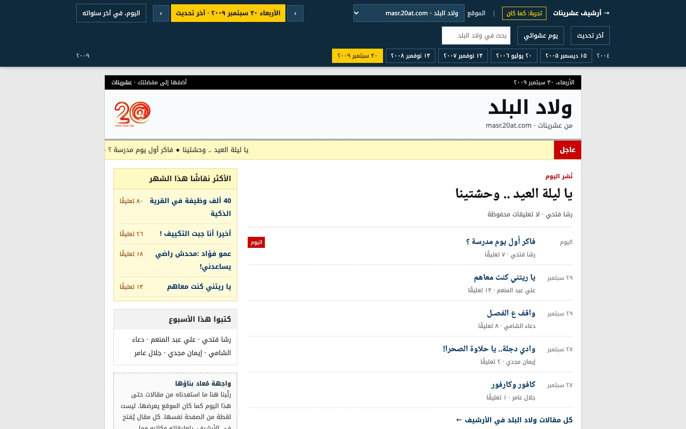

+++
title = "أرشيف عشرينات"
weight = 3
description = "محاولة لاستعادة ما ضاع من موقع عشرينات، من أرشيف الإنترنت."
template = "project.html"

[extra]
year = "2026"
image = "cover.jpg"
image_alt = "الصفحة الرئيسية لأرشيف عشرينات: قصة الموقع، وما استعدناه منه حتى الآن، ورسم بياني لست سنوات من المقالات والتعليقات شهرًا بشهر."
website = "https://20at.mosab.me"
+++

عشرينات موقع شبابي عربي من القاهرة، انطلق في فبراير ٢٠٠٤ ومعه مواقع فرعية،
حتى ١٥ مارس ٢٠١٠؛ بعدها صار موقعًا آخر بالاسم نفسه، ومُحي محتواه القديم كله.

يجمع هذا المشروع ما وجدناه من كنوزه في أرشيف الإنترنت، حتى ذلك اليوم لا بعده،
ويعيد بناءها لتُقرأ من جديد: المقالات وكُتّابها وأقسامها، وتعليقات القرّاء
واستفتاءاتهم والوسائط التي صاحبتها.

وفي آلة الزمن تختار أحد المواقع ويومًا، فترى واجهته كما كانت يومها، مبنيّة
مما استعدناه من مقالات حتى ذلك اليوم.
