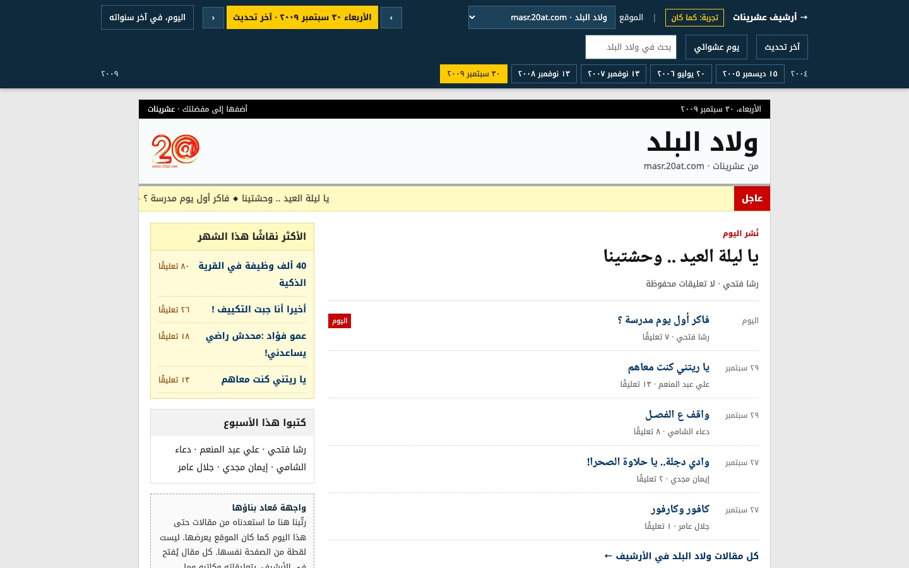

+++
title = "20at Archive"
weight = 3
description = "Bringing back 20at.com, a lost Arabic youth website from Cairo, rebuilt from the Internet Archive's captures."
template = "project.html"

[extra]
year = "2026"
image = "cover.jpg"
image_alt = "The 20at Archive home page: the story of the site, what has been restored so far, and a chart of six years of articles and comments month by month."
website = "https://20at.mosab.me"
+++

20at.com (عشرينات) was an Arabic youth website from Cairo. It launched in
February 2004, grew a family of sub-sites around it, and ran until 15 March
2010, when the name went to a different site and all of the old content was
wiped.

This project recovers what it can of the original from the Wayback Machine's
captures, strictly up to that last day, and rebuilds it as a site to be read
again: the articles, their writers and sections, and the readers' comments,
polls and media that came with them.

A time machine lets you pick one of the sites and a day, and see its front
page the way it stood then, rebuilt from the articles restored up to that day.
